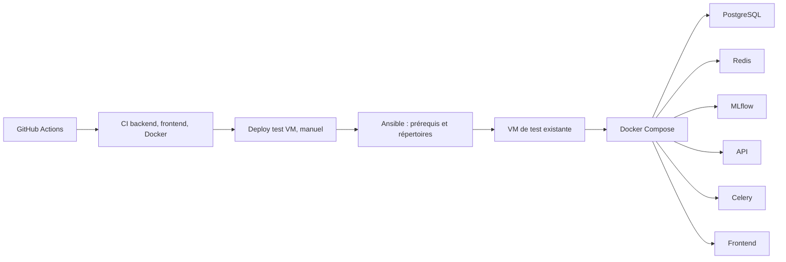
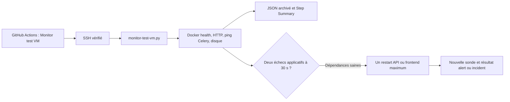

# Runbook de la VM de test existante

Ce document décrit l'exploitation de la VM scolaire **déjà provisionnée**. Il ne contient ni IP publique ni secret. Les contrôles sont en lecture seule ; déploiement, rollback, redémarrage de conteneurs et maintenance sont des opérations distinctes, à n'exécuter qu'après validation de leur contexte.

## Responsabilités et flux





## Préparer la VM avec Ansible

1. Depuis un environnement disposant d'Ansible (WSL convient), définir localement `TEST_HOST` avec l'adresse **actuelle**, `TEST_USER` et `SSH_KEY_PATH` avec le chemin Linux de la clé privée. Ne jamais les committer ; la clé doit être lisible uniquement par son propriétaire (`chmod 600`).
2. Vérifier indépendamment l'empreinte de la clé hôte SSH. Ne pas accepter aveuglément une nouvelle clé hôte.
3. Lancer le playbook :

   ```bash
   ANSIBLE_HOST_KEY_CHECKING=True ansible-playbook \
     -i "$TEST_HOST," -u "$TEST_USER" \
     --private-key "$SSH_KEY_PATH" deploy/prepare-test-vm.yml
   ```

Le [playbook](../deploy/prepare-test-vm.yml) vérifie Docker et Compose, puis crée `~/satisfaction-test`, `releases` et `shared` avec les permissions prévues. Il ne provisionne pas la VM, n'installe pas Docker et ne touche pas à MicroK8s. Un second passage doit produire `changed=0` ; voir [la preuve](DEVOPS_EVIDENCE.md).

## Secrets GitHub et IP dynamique

L'environnement GitHub `test` nécessite `TEST_HOST`, `TEST_USER`, `TEST_SSH_KEY`, `TEST_SSH_KNOWN_HOSTS` et `TEST_ENV_FILE` pour le déploiement. Le workflow de supervision réutilise les quatre premiers et ne lit pas `TEST_ENV_FILE`. Seuls les **noms** de ces secrets figurent dans le dépôt ; ne jamais copier leur valeur dans un ticket, un log ou un document.

Après un changement d'IP publique de la VM scolaire, relever la nouvelle adresse auprès de l'environnement scolaire, vérifier la nouvelle clé hôte par un canal indépendant, puis mettre à jour **ensemble** `TEST_HOST` et `TEST_SSH_KNOWN_HOSTS` dans l'environnement GitHub `test`. Une clé hôte inattendue ne doit pas être supprimée ou acceptée sans vérification. Le dépôt ne doit contenir aucune IP publique de cette VM.

Le fichier de configuration applicative est transféré hors Git vers `~/satisfaction-test/shared/test.env` en mode `600` par [deploy-test.yml](../.github/workflows/deploy-test.yml). Le redémarrage d'une base PostgreSQL existante avec un nouveau mot de passe dans ce fichier ne modifie pas le mot de passe stocké dans le volume initial.

## Déployer une révision et vérifier ce qui est servi

1. Vérifier que la CI du SHA de `main` est verte.
2. Lancer **manuellement** `Deploy test VM` sur `main` dans GitHub Actions. Le workflow vérifie le SHA exact, exécute Ansible, transfère une archive Git, construit et démarre Compose, puis attend API et frontend. Le déploiement n'est annoncé comme réussi qu'après ses healthchecks.
3. Lire le Step Summary du run et comparer le SHA demandé au SHA déployé.
4. Sur une session SSH déjà vérifiée, effectuer les contrôles en lecture seule :

   ```bash
   cd "$HOME/satisfaction-test"
   cat current.sha
   test -f previous.sha && cat previous.sha
   docker ps --filter 'label=com.docker.compose.project=satisfaction-test'
   curl --fail --silent http://127.0.0.1:8000/health
   curl --fail --silent --output /dev/null http://127.0.0.1:5173/
   df -h /
   ```

`current.sha` est la version réellement servie ; elle peut différer du dernier commit `main` après un rollback. `/health` contrôle l'accès PostgreSQL de l'API. Les healthchecks Compose contrôlent séparément PostgreSQL, Redis, MLflow, API et frontend. Un conteneur Celery simplement `running` n'est pas une preuve fonctionnelle : la sonde utilise aussi `celery inspect ping`.

Le [déploiement RC 41639303247](https://github.com/PiKwaii93/satisfaction-scraper/actions/runs/41639303247) a servi `f99789099fc3fa16a0c6cc2e0537e00eafc56776` avec `HEALTHCHECK=passed`. Un arrêt ultérieur de la VM pédagogique a temporairement rendu SSH indisponible ; le déploiement était déjà terminé. Après rallumage, `current.sha` et les volumes étaient conservés.

## Reprendre la stack après un reboot de la VM

Sur la VM observée en lot 10B, seul PostgreSQL avait `restart: always` : après reboot, les autres services applicatifs étaient arrêtés. **Ne pas supposer que toute la stack revient seule.** Vérifier d'abord l'IP actuelle auprès de la plateforme scolaire, la clé hôte SSH par un canal indépendant, puis `current.sha`, la release correspondante, l'état des conteneurs et l'espace disque. Si l'IP a changé, actualiser uniquement `TEST_HOST` et `TEST_SSH_KNOWN_HOSTS` dans l'environnement GitHub `test` après vérification ; ne jamais copier une IP éphémère dans le dépôt.

Si les conteneurs et volumes de `satisfaction-test` existent et correspondent à `current.sha`, redémarrer **ces conteneurs existants** avec le fichier Compose de la release servie et `shared/test.env` :

```bash
root="$HOME/satisfaction-test"
sha=$(cat "$root/current.sha")
release="$root/releases/$sha"
test "$(cat "$release/.source_sha")" = "$sha"
compose=(docker compose --project-directory "$release" --env-file "$root/shared/test.env" -p satisfaction-test -f "$release/docker-compose.yml")
"${compose[@]}" start postgres_db redis mlflow
"${compose[@]}" start api celery_worker frontend
```

Attendre leurs healthchecks, vérifier API `/health`, frontend HTTP, `pg_isready`, Redis `PONG`, MLflow `/health` et `celery inspect ping`. Le `model_bootstrap` terminé en `Exited (0)` n'a pas à être recréé. Cette reprise ne requiert ni `build`, ni `up`, ni `down`, ni nouveau déploiement et ne change pas `current.sha`. Si des conteneurs ou volumes manquent, arrêter le diagnostic et traiter ce cas séparément.

## Consulter l'application via tunnel

Les ports applicatifs sont liés au loopback de la VM. Depuis le poste de travail, avec `TEST_HOST`, `TEST_USER` et `SSH_KEY_PATH` définis localement :

```bash
ssh -i "$SSH_KEY_PATH" \
  -L 5173:127.0.0.1:5173 \
  -L 8000:127.0.0.1:8000 \
  -L 5000:127.0.0.1:5000 \
  "$TEST_USER@$TEST_HOST"
```

Ouvrir ensuite le frontend, l'API et MLflow sur les ports `localhost` correspondants. Le tunnel ne rend pas ces services publics.

## Rollback applicatif manuel

Vérifier d'abord `current.sha`, `previous.sha`, la compatibilité de l'ancien code avec le schéma DB courant et la disponibilité d'une sauvegarde appropriée. Depuis la VM, le mécanisme prévu est :

```bash
cd "$HOME/satisfaction-test"
current=$(cat current.sha)
bash "releases/$current/deploy/test-deploy.sh" rollback
cat current.sha
cat previous.sha
curl --fail --silent http://127.0.0.1:8000/health
```

Le script réactive la révision précédente et réévalue API et frontend. Il ne réalise **aucun downgrade Alembic** et ne restaure pas PostgreSQL. Le rollback manuel de [la preuve](DEVOPS_EVIDENCE.md) portait sur un second commit vide ; ne pas le présenter comme validation d'un retour entre fonctionnalités différentes.

## Superviser et réagir aux alertes

Le workflow [Monitor test VM](../.github/workflows/monitor-test.yml) peut être lancé manuellement dans GitHub Actions. Son Step Summary et son artefact `monitor-report.json` donnent l'heure, `current.sha`, l'état de chaque composant, HTTP, ping Celery, disque, alerte et remédiation. Le premier [run réel manuel](https://github.com/PiKwaii93/satisfaction-scraper/actions/runs/35726582579) était sain. Le cron final est horaire à la minute 17. Le [heartbeat planifié](https://github.com/PiKwaii93/satisfaction-scraper/actions/runs/35765192366) a réussi ; son workflow de diagnostic a ensuite été retiré. Un [run Monitor planifié](https://github.com/PiKwaii93/satisfaction-scraper/actions/runs/35764642522) a été créé, mais son job a été `skipped` car `TEST_MONITOR_SCHEDULE_ENABLED=false`. L'événement `schedule` est démontré ; aucune sonde planifiée active de la VM ne l'est encore. Sans activation explicite, le run peut être créé sans contacter la VM.

Sur une release compatible, `application_snapshot` ajoute les états courants des analyses au rapport. Les [runs réels 41646917782 et 41662964180](DEVOPS_EVIDENCE.md#déploiement-et-supervision-réels-du-candidat-lot-10b) ont confirmé `supported=true`, `available=true`, 1 analyse terminée et 15 avis traités. Le premier workflow a conclu `failure` **parce que son rapport valait `alert`**, avec moins de 5 GiB libres et une stack saine ; le second a conclu `success` avec `result=healthy` après maintenance. Lire le JSON avant d'interpréter une conclusion Actions comme une panne applicative.

Deux échecs applicatifs espacés de 30 secondes autorisent au plus **un** restart de `api` ou `frontend` si leurs dépendances sont saines ; une troisième sonde est archivée. Un incident récupéré reste `alert`. Aucune remédiation automatique n'est prévue pour SSH, disque, PostgreSQL, Redis, MLflow ou Celery. Le ping Celery prouve seulement que le worker répond à l'instant du contrôle.

Si le rapport indique un **échec SSH**, vérifier d'abord que la VM est démarrée, puis l'adresse actuelle, l'accès réseau et la clé hôte vérifiée. Une VM arrêtée ou inaccessible donne volontairement un incident SSH ; ne pas redémarrer ni reconfigurer la VM par automatisme. Si le disque libre descend sous **5 GiB**, l'alerte est informative : relever `df -h /` et `docker system df`, identifier la source de consommation et convenir d'une action manuelle compatible avec les ressources scolaires. Aucune purge automatique.

La maintenance du lot 10B a libéré de la place par nettoyage des caches apt/pip/conda, des journaux systemd et du cache de build Docker (`docker builder prune -f`), **après diagnostic**. L'espace libre est repassé au-dessus du seuil de 5 GiB ; un nouveau Monitor a confirmé `healthy`. Ne pas supprimer les volumes PostgreSQL/MLflow, les données `satisfaction-test`, ni utiliser `docker system prune -a` ou `docker volume prune` pour masquer l'alerte. Cette maintenance reste manuelle ; le monitor ne purge rien.

## Actions interdites sur la VM scolaire

- Pas de `docker system prune` automatique, ni de `docker compose down -v`.
- Pas de suppression de volumes, d'anciens conteneurs ou d'images scolaires.
- Pas de modification de MicroK8s.
- Pas de restauration de base ou de downgrade de migration automatique.
- Pas de redémarrage global de la VM comme remédiation automatique.

Voir [TRACEABILITY.md](TRACEABILITY.md) pour l'état des exigences et [DEVOPS_EVIDENCE.md](DEVOPS_EVIDENCE.md) pour les runs et les limites de preuve.
